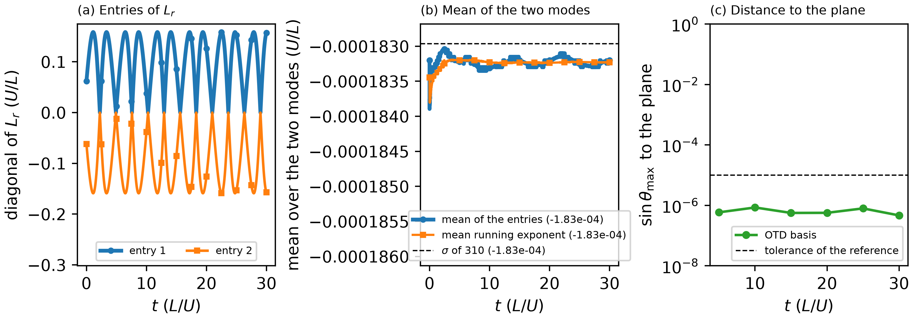

# cubic_cavity_re1914 / 500_otd — two OTD modes on the steady cavity flow

## What this case shows

An OTD basis (optimally time-dependent modes, `userParam01 = 5`) is a small set of orthonormal
perturbation fields that evolve with the linearized Navier-Stokes equations and follow the
leading directions of the flow. Here two modes (`lpert = 2` in `SIZE`) evolve about the steady
flow of `../210_baseflow_newton/fp/` at Re = 1914, which the DNS does not advance (frozen base
flow). The leading eigenpair of `../310_stability_direct/` is a weakly damped complex pair,
sigma = -1.829623e-4 and omega = 0.586836, just below the Hopf bifurcation at Re = 1916.63.

The two basis vectors start as the real and the imaginary part of that eigenmode. They span the
invariant plane of the pair. The linearized operator maps this plane onto itself, so the basis
must stay on it, and the trace of the reduced operator `Lr` on the plane must stay 2 sigma. The
stage checks both. It is a check of the OTD machinery on a 3D case with 1000 elements, in which
the number of elements per rank is below `lelt` (the normal case in a run), not a physics result.

## What the stage compares

The basis rotates inside the plane at the frequency omega of the pair, and each diagonal entry of
`Lr` follows the rotation: the entries swing between +0.16 and -0.16 (panel a of the figure).
Only half the trace, the mean of the two entries, equals sigma (panel b). The expected values
come from `../310_stability_direct/` (`Spectre_NSd.dat` and the two mode files), not from a value
read back from an OTD run. `plot.py` reads the run and writes `otd_summary.dat`.

| quantity | expected | observed | tolerance |
|---|---|---|---|
| mean of the two entries of `Lr` at t = 0 | sigma = -1.829623e-4 | -1.8320e-4 | 2e-6 |
| the same mean at t = 30 | sigma | -1.8320e-4 | 2e-6 |
| spread of that mean for t > 0 | 0 | 8.6e-7 | 1e-5 |
| mean of the two running exponents (`otd_ftle.dat`) at t = 30 | sigma | -1.8323e-4 | 2e-6 |
| sine of the largest principal angle between the basis (written at t = 5, 10, ..., 30) and the plane | 0 | 4.7e-7 at t = 30, at most 8.5e-7 | 1e-5 |

The mean stays within 1e-6 of sigma at every time (2.4e-7 below it at t = 0 and at t = 30), and the
basis stays on the plane to 1e-6 for the 2.8 periods of the run. The observed values are from Jean
Zay (40 ranks, 25 or 26 elements per rank against `lelt = 65`, 733 s, `ifort`).



Each tolerance is tight enough to fail a defect that this stage met while it was built:

- A product of the basis with the reduced operator that took the number of elements of the rank
  as the spacing of the basis arrays, where the arrays are spaced by `lelt`: the second mode left
  the plane within 3 time units (sine 0.35).
- The viscous term of `Lr` in strong form (two applications of the gradient inside the element,
  no sum over the faces) instead of the weak form of the time stepper: the mean of the entries was
  -4.0e-3 at t = 0.
- The gradient of the pressure that Nek5000 maps to the velocity mesh and averages across the
  element faces, added to `Lr`: the mean moved to -3.86e-4 after the first step. The pressure of
  the stepper adds nothing to `Lr`, because every basis vector satisfies the discrete
  incompressibility constraint of the stepper (the pressure term measured 1e-13 of the entries),
  so `Lr` has no pressure term.

## Run

```bash
printf "cav\n%s/\n" "$(pwd)" > SESSION.NAME
mks cav
sbatch run.local.slurm      # 16 ranks; 12 min on 40 ranks of Jean Zay
python3 plot.py
python3 ../../../scripts/check_against_ref.py .
```

`run.local.slurm` copies `BF_cav0.f00001` from `../210_baseflow_newton/fp/` and the two mode files
`dRecav0.f00001` and `dImcav0.f00001` from `../310_stability_direct/` as the first and second
basis vector (the field files are not tracked), and writes the probe list `cav.his`. It removes
the `r0?cav0.f*` files of an earlier run first, because the driver reads the highest number it
finds. `OTD_SEED=0` starts from white noise; the reference does not apply to that start.
`endTime = 30` is 2.8 periods of the pair. The sponge is off, as in the 310 stage.

## Files

- `plot.py` — reads `otd_eigenvalues.dat`, `otd_ftle.dat`, the basis files `r01cav0.f*` and
  `r02cav0.f*`, and the eigenpair of `../310_stability_direct/`; writes `otd_summary.dat` and
  `plot_otd.png`
- `otd_eigenvalues.dat` — time and the two diagonal entries of `Lr`
- `otd_ftle.dat` — time and the running finite-time exponent of each mode
- `otd_summary.dat` — the values of the table above
- `ref/reference.json`, `ref/otd.png` — regression values and figure

## Reference

Babaee and Sapsis (2016), Proc. R. Soc. A 472: 20150779.
