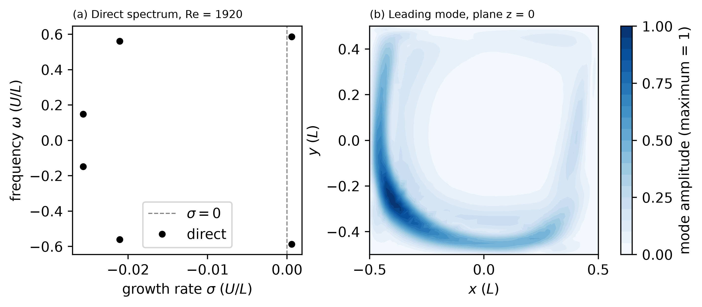

# cubic_cavity_re1920 / 310_stability_direct

**uparam01**: 3.1 (Krylov-Schur, Arnoldi window `endTime` = 2.0, `k_dim` = 120, 6 eigenvalues written)
**Re**: 1920, 16 ranks at least (`lpmin = 16`)

Direct stability about the steady flow of `../210_baseflow_newton/fp/` at Re = 1920, uniform lid.
Copy the Newton `BF_cav0.f00001` here, then `sbatch run.local.slurm`. The window `endTime` = 2.0 gives
omega T = 1.17 for the leading pair, below pi, so the pair is not aliased. The converged
eigenvalues are in `Spectre_NSd_conv.dat` (sigma and omega in units of U/L).

## Result

Re = 1920 lies above the first Hopf bifurcation. The leading pair has a positive growth rate: the
steady flow is unstable. Run on Jean Zay, 40 ranks, 2229 s (120 matrix-vector products of 1392
steps, 47 eigenvalues converged to 1e-6, the six leading ones written):

| pair | sigma, Re = 1920 | omega, Re = 1920 | sigma, Re = 1914 | omega, Re = 1914 |
|---|---|---|---|---|
| 1 | +5.8448e-4 | 0.58679 | -1.8296e-4 | 0.58684 |
| 2 | -2.1060e-2 | 0.56085 | -2.0493e-2 | 0.56094 |
| 3 | -2.5659e-2 | 0.14826 | -2.6071e-2 | 0.14771 |

The Re = 1914 columns come from `../../cubic_cavity_re1914/310_stability_direct/`. Between the two
Reynolds numbers the frequencies change by 5.5e-4 at most and the growth rates by 4e-4 to 8e-4; only
the growth rate of the leading pair changes sign. The frequency of the leading pair, 0.5868, is
2 pi St with St = 0.0934 of the thesis
(Table 4.1, Re_c = 1916.63). Linear interpolation of the two growth rates puts the zero of sigma
at Re = 1915.4 on this mesh (1000 elements, `lx1 = 6`); the thesis value is 1916.63 and the
literature range is 1914 to 1919.5 (see `../../cubic_cavity_re1914/README.md`).

## Reference

`ref/reference.json` checks sigma and omega of the leading pair (tolerances 2e-5 and 1e-4) and of the
second pair (1e-3 and 2e-3). The values are those of the run above. The tolerance on sigma of the
leading pair is 3.4 % of its value: the Re = 1914 spectrum fails it (sigma = -1.83e-4), as does a run at
a Reynolds number that is wrong by 0.2. Verify with
`python3 ../../../scripts/check_against_ref.py .`.

## Figure

`python3 plot.py` writes `plot_spectrum.png`: (a) the converged spectrum and (b) the amplitude of the
leading mode on the plane z = 0. `ref/spectrum.png` is the figure of that run.
