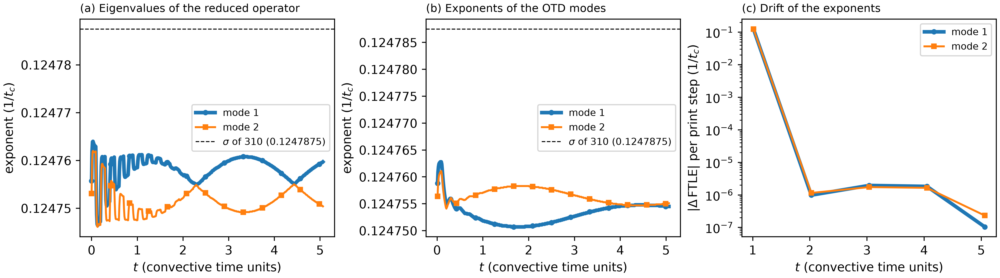

# cylinder_re100 / 500_otd — OTD about the steady wake (`userParam01 = 5`)

## What this case shows

An OTD basis of two orthonormal perturbations evolves with the linearized Navier-Stokes
equations about a **frozen** base flow, the steady wake of `310_stability_direct`
(`startFrom = BF_1cyl0.f00001`; the DNS is not advanced). The Gram-Schmidt step keeps the
basis orthonormal; the reduced operator `Lr` and the finite-time exponents (FTLE) follow
the subspace of fastest growth. About a steady base flow the exponents must approach the
growth rate of the leading eigenvalue pair of the 310 stage, sigma = 0.12479
(omega = 0.7337).

`lpert = 2` in `SIZE`: the leading pair is a complex pair, so two modes hold its invariant
subspace. The next eigenvalues of 310 have real parts of -0.005 to -0.03, so they are
separated from the pair by about 0.13.

OTD about a base flow that the DNS advances is `userParam01 = 5.1`; see `../../cylinder_re180/500_otd/`.

## Start

`run.local.slurm` copies `BF_1cyl0.f00001`, `dRe1cyl0.f00001` and `dIm1cyl0.f00001` from
`../310_stability_direct/direct/`. The driver reads the last two as the initial
perturbations `r01`, `r02`: the real and imaginary parts of the leading eigenmode, an
exact start on the invariant subspace. The run script first removes `r0?1cyl0.f*` files of
an earlier run, because a run writes files with these names and the driver reads the
highest number it finds.

`OTD_SEED=0 sbatch run.local.slurm` starts from white noise instead. Set `endTime = 200`
in `1cyl.par` for that start.

## No sponge

`1cyl.usr` sets `spng_st = 0`. With the sponge on, the perturbation operator differs from
the operator of the 310 stage, which has no sponge, and the exponents do not match it.

## Result (seeded start)

Growth rate of the leading pair in `310_stability_direct`: sigma = 0.1247875 (`Spectre_NSd.dat`).
Observed on Jean Zay (8 ranks, 22 s, `ifort`):

| quantity | value | difference to sigma |
|---|---|---|
| eigenvalues of `Lr` at t = 0 (`otd_eigenvalues.dat`, first row) | 0.1247557, 0.1247531 | -3.2e-5, -3.4e-5 |
| FTLE at the end of the run, t = 5.06, step 500 (`otd_ftle.dat`, last row) | 0.1247545, 0.1247551 | -3.3e-5, -3.2e-5 |

The basis starts on the invariant subspace of the pair and stays on it. The two eigenvalues of
`Lr` differ by 1.2e-5 at most (the rotation at omega = 0.7337 is carried by the basis), and
their mean stays between 0.124746 and 0.124763 for the whole run. The run ends by the
convergence test of the driver (see below) at step 500, before `endTime = 30`.

`ref/reference.json` compares all four values with sigma of the 310 stage, not with a value
read back from an OTD run, at a tolerance of 1e-4 (8e-4 of sigma). `python3 plot.py` writes
`plot_otd.png`; `ref/otd.png` is that figure from the run above.

### Why the values lie 3.3e-5 below sigma

The 310 stage does not give the growth rate of the spatial operator. It gives the growth rate
of its own map: one period of the leading mode, `endTime = 1`, integrated with the time step
`dt = 1/99` (`dt = 0` in the `.par` of the stage, so the solver takes the step from a CFL
number of 0.5). The OTD reads the spatial operator on the current fields and does not depend on
`dt` in that way. Running the 310 stage with a smaller `dt` shows the difference:

| `dt` of the 310 stage | sigma | sigma minus the value at `dt = 1/792` |
|---|---|---|
| 1/99 (as shipped) | 0.1247875 | +3.5e-5 |
| 1/198 | 0.1247611 | +8.3e-6 |
| 1/396 | 0.1247545 | +1.7e-6 |
| 1/792 | 0.1247528 | 0 |

The difference falls by 4.2 and then 4.9 for each halving of `dt`, close to the factor 4 of an
error that grows with `dt` squared. Extrapolating the last three rows with that factor gives
0.124752 for `dt` going to 0. The OTD values lie within 4e-6 of it (table above), and so does
the white-noise run below (0.124752). The stage therefore compares the OTD with the 310 stage
to the accuracy of the time step of the 310 stage. The tolerance of 1e-4 is three times that
offset. It still fails a defect met while the stage was built: the second exponent was 0.124519
(2.7e-4 low) when the product of the forcing with the basis took arrays of `nv` points instead
of `lelv*lxyz` points.

### White-noise start (`OTD_SEED=0`, `endTime = 200`)

The mean of the diagonal of `Lr` over windows of the run, mode 1 and mode 2:

| window | mode 1 | mode 2 | mean |
|---|---|---|---|
| 30 to 40 | 0.15328 | 0.14282 | 0.14805 |
| 40 to 60 | 0.14313 | 0.13403 | 0.13858 |
| 60 to 80 | 0.12744 | 0.12533 | 0.12639 |
| 80 to 100 | 0.12495 | 0.12473 | 0.12484 |
| 100 to 200 | 0.124757 | 0.124748 | 0.124752 |

From random fields the basis reaches the leading pair after about 100 convective time units.
Then the mean of the two entries equals the growth rate of the spatial operator, 0.124752. The
running FTLE of `otd_ftle.dat` is still 0.1042 and 0.1059 at t = 200, because it averages over
the transient from t = 0. Use a window mean, or `otd_FTLEPeriod`, to read the exponent of a run
that starts from noise.

## Why the other OTD defaults stay

The OTD improvement pass (five candidates) changed no default. The orthonormalization uses
`lpert (lpert + 1) / 2` global reductions every `otd_gsStep = 10` steps, about one per time
step, against tens inside the Helmholtz and pressure solves of the same step. A Gram matrix
(`k_gram_matrix`) or an adaptive cadence would save a fraction of one reduction per step and
change the rounding of the results. The exponents are a running average from the start of
the run (or from the start of each window of `otd_FTLEPeriod`); a restart starts a new
average. The convergence test stops the run when the exponents change by less than
`otd_convTol = 1e-6` between two print steps, after `otd_minSteps = 200` steps. A running
average approaches its limit as `C / t`, so its change per print step is about
`C * dt_print / t^2`, smaller than the remaining error `C / t` by the factor
`dt_print / t` (about 1/20 at `t = 20`). The test can therefore stop a run before the
subspace has converged. It is left as it is, since another tolerance changes when a run
stops, not what it computes; a run that must not stop early sets a smaller `otd_convTol` or
a larger `otd_minSteps` in `nekStab_usrchk`.

## Files

- `plot.py` — reads `otd_eigenvalues.dat`, `otd_ftle.dat` and `Spectre_NSd.dat` of the 310 stage; writes `plot_otd.png`
- `otd_eigenvalues.dat` — time, real parts of the eigenvalues of `Lr`
- `otd_growth_rates.dat` — time, eigenvalues of the symmetric part of `Lr`
- `otd_ftle.dat` — time, FTLE of each mode
- `otd_residuals.dat` — time, change of the FTLE per print step
- `ref/reference.json`, `ref/otd.png` — regression values and figure

## Reference

Babaee and Sapsis (2016), Proc. R. Soc. A 472: 20150779.
