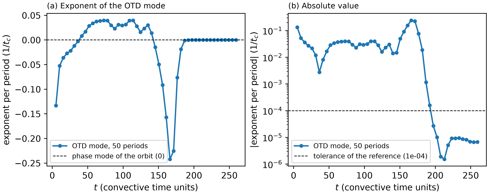

# cylinder_re180 / 500_otd — OTD about the Newton orbit (`userParam01 = 5.1`)

## What this case shows

One OTD mode (`lpert = 1`) evolves with the linearized Navier-Stokes equations about the
periodic orbit of `210_baseflow_newton`, while the DNS advances the base flow along the
orbit. This is `userParam01 = 5.1` (`'otd_dns'`). `userParam01 = 5` would keep the base flow
at the field of `BF_1cyl0.f00001`, which suits a steady base flow (see
`../../cylinder_re100/500_otd/`).

`otd_FTLEPeriod` is set to one period of the orbit, T = 5.189628, so `otd_ftle_period.dat`
holds the exponent of the mode for each period: time at the end of the period, exponent.
For a periodic base flow the exponent of the leading OTD mode converges to the largest
Floquet exponent of the orbit. At Re = 180 in 2D that is the phase mode, multiplier 1 and
exponent 0 (`../311_stability_direct_floquet/` gives 3.4e-6). The converged exponent must
therefore be 0.

Re = 180 in 2D is a proxy: this stage checks the OTD machinery against an exponent known
from theory. It says nothing about Mode A or Mode B, which need a 3D flow.

## Start

`run.local.slurm` copies `BF_1cyl0.f00001` from `../210_baseflow_newton/` (the field file is
not tracked) and removes `r0?1cyl0.f*` files of an earlier run. With no such file the driver
starts from white noise, which this stage uses. `SIZE` has `lpert = 1` and the polynomial
order of the Newton stage (`lx1 = 8`), so the orbit is read without interpolation.

`1cyl.usr` sets `otd_convTol = 0`, which turns the early stop off. The stop compares the
running average of the exponents between two print steps, and that changes little long
before the exponent has converged (the explanation is in
`../../cylinder_re100/500_otd/README.md`). `otd_residuals.dat` stays empty for this reason.

## Result (white-noise start, 50 periods)

Run on 8 ranks of Jean Zay (`ifort`), 3253 s.

| period | t at the end | exponent of the period |
|---|---|---|
| 1 | 5.19 | -1.33e-1 |
| 10 | 51.90 | +2.85e-2 |
| 20 | 103.80 | +3.13e-2 |
| 30 | 155.69 | -9.15e-2 |
| 32 | 166.07 | -2.42e-1 |
| 36 | 186.83 | -1.17e-3 |
| 37 | 192.02 | -1.59e-4 |
| 38 | 197.21 | -2.70e-5 |
| 40 | 207.59 | -1.91e-6 |
| 45 | 233.53 | +9.49e-6 |
| 50 | 259.48 | +6.73e-6 |

The first 37 periods (190 time units) are the transient of the white-noise start: the
exponent of a period is the growth of the current basis vector, and that vector is not yet
the phase mode. From period 38 on, the exponent stays below 2.7e-5 in absolute value (below 1.1e-5
from period 39 on), so it agrees with the exponent 0 of the phase mode to that level. The
transient depends on the start field.



The running exponent of `otd_ftle.dat` averages from t = 0, so it still carries the
transient: it is -5.9e-3 at t = 260. Read `otd_ftle_period.dat` for this stage.

`ref/reference.json` compares the exponent of the last period with 0, the exact value of the
phase mode, with a tolerance of 1e-4. The value is not read back from an OTD run.
`python3 plot.py` writes `plot_otd.png`; `ref/otd.png` is that figure from the run above.

## Run

```bash
mks 1cyl
sbatch run.local.slurm      # 8 ranks, 54 min on Jean Zay
python3 plot.py
python3 ../../../scripts/check_against_ref.py .
```

## Files

- `otd_ftle_period.dat` — time at the end of the period, exponent of the mode in that period
- `otd_ftle.dat` — time, running exponent from t = 0
- `otd_eigenvalues.dat`, `otd_growth_rates.dat` — time, eigenvalues of the reduced operator and of its symmetric part
- `plot_otd.png` — figure from `python3 plot.py`

## Reference

Babaee and Sapsis (2016), Proc. R. Soc. A 472: 20150779.
