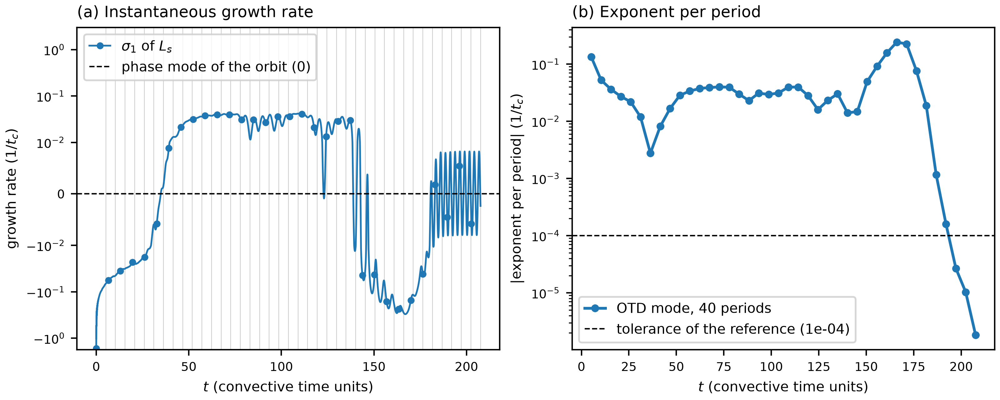
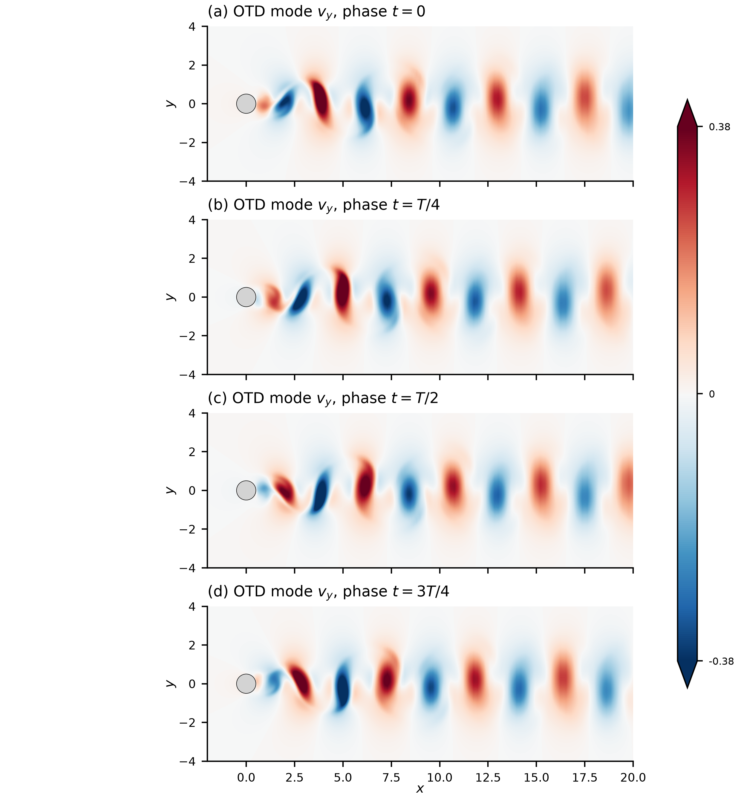
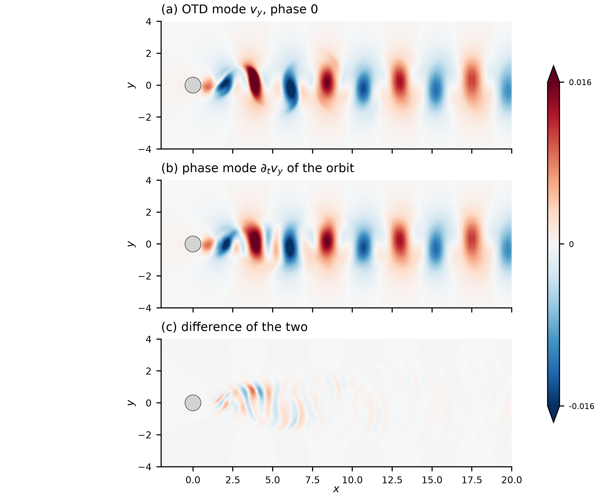

# cylinder_re180 / 500_otd — OTD about the Newton orbit (`userParam01 = 5.1`)

## What this case shows

One OTD mode (`lpert = 1`) evolves with the linearized Navier-Stokes equations about the
periodic orbit of `210_baseflow_newton`, while the DNS advances the base flow along the
orbit. This is `userParam01 = 5.1` (`'otd_dns'`). `userParam01 = 5` would keep the base flow
at the field of `BF_1cyl0.f00001`, which suits a steady base flow (see
`../../cylinder_re100/500_otd/`).

`otd_FTLEPeriod` is set to one period of the orbit, T = 5.189628, so `otd_ftle_period.dat`
holds the exponent of the mode for each period: time at the end of the period, exponent.
For a periodic base flow the exponent of the leading OTD mode converges to the largest
Floquet exponent of the orbit. At Re = 180 in 2D that is the phase mode, multiplier 1 and
exponent 0 (`../311_stability_direct_floquet/` gives 3.4e-6). The converged exponent must
therefore be 0.

Re = 180 in 2D is a proxy: this stage checks the OTD machinery against an exponent known
from theory. It says nothing about Mode A or Mode B, which need a 3D flow.

## Start

`run.local.slurm` copies `BF_1cyl0.f00001` from `../210_baseflow_newton/` (the field file is
not tracked) and removes `r0?1cyl0.f*` files of an earlier run. With no such file the driver
starts from white noise, which this stage uses. `SIZE` has `lpert = 1` and the polynomial
order of the Newton stage (`lx1 = 8`), so the orbit is read without interpolation.

`1cyl.usr` sets `otd_convTol = 0`, which turns the early stop off. The stop compares the
running average of the exponents between two print steps, and that changes little long
before the exponent has converged (the explanation is in
`../../cylinder_re100/500_otd/README.md`). `otd_residuals.dat` stays empty for this reason.

## Result (run of 2026-10-28, two phases)

Run on 8 ranks of Jean Zay (`ifort`).

Phase 1: white-noise start, 40 periods of the orbit (endTime = 207.585). The outputs are
`p1_otd_*.dat`.

| period | t at the end | exponent of the period |
|---|---|---|
| 1 | 5.19 | -1.33e-1 |
| 10 | 51.90 | +2.85e-2 |
| 20 | 103.80 | +3.13e-2 |
| 30 | 155.69 | -9.15e-2 |
| 32 | 166.07 | -2.42e-1 |
| 36 | 186.83 | -1.17e-3 |
| 37 | 192.02 | -1.59e-4 |
| 38 | 197.21 | -2.68e-5 |
| 39 | 202.40 | +1.03e-5 |
| 40 | 207.59 | -1.83e-6 |

The first 37 periods (190 time units) are the transient of the white-noise start: the
exponent of a period is the growth of the current basis vector, and that vector is not yet
the phase mode. From period 38 on, the exponent stays below 2.7e-5 in absolute value, so it
agrees with the exponent 0 of the phase mode to that level. The transient depends on the
start field.




The growth rate of panel (a) is the largest eigenvalue of the symmetric part of the reduced
operator (`otd_growth_rates.dat`, one value per time step). It oscillates within each period;
in the last periods it stays within +-6.5e-3 and its mean over a period is the exponent of
panel (b). The running exponent of `otd_ftle.dat` averages from t = 0, so it still carries the
transient. Read `otd_ftle_period.dat` for this stage.

Phase 2: restart of the OTD basis from the field at 40 T (`start40T_r011cyl0.f00001`, the
base flow is back at orbit phase 0), one period (endTime = T), `r011cyl0.f00001` to
`f00008` every T/8 (the OTD mode) and `1cyl0.f00001` to `f00008` (the orbit at the same
times). `otd_*.dat` of this phase hold that period; `otd_ftle_period.dat` gives 2.68e-5.
Snapshot k is at t = k T/8 after the restart, so snapshot 8 is at phase 0 again; the basis
there differs from the restart basis by 0.9 % in relative L2 norm.



The mode is a train of alternating structures along the wake that moves downstream
during the period (`ref/otd_mode.gif` shows the 8 snapshots with a fixed colour scale).

### Comparison with the phase mode

The phase mode of the orbit is dU/dt (multiplier 1). `ref/otd_vs_floquet.png` compares the
OTD mode at phase 0 with dU/dt of the orbit at phase 0, both scaled to unit L2 norm (vx and vy
at all nodes of the 2128-element mesh, sum over nodes) and with the sign aligned. The field
`dRe1cyl0.f0000N` of `../311_stability_direct_floquet/` is not used: its time stamps are
1, 2, 3 and `311_stability_direct_floquet/plot.py` records that the stored files are not the
phase mode. dU/dt comes from the 8 snapshots of one period by a Fourier derivative in time.
The relative L2 difference is 0.46, 0.39 and 0.23 when the derivative keeps harmonics up to
1, 2 and 3. Harmonics 3 and 4 of the orbit carry about the same energy (norms 44 and 42, against 2849 for the
mean and 319 for harmonic 1), so 8 snapshots per period do not resolve dU/dt: the
difference of 0.23 is the same size as the difference between a Fourier and a central-difference estimate
(0.24). The figure therefore shows the same wake structures at the same positions, and it does
not fix the agreement better than about 0.2. A run that writes 32 snapshots per period
would settle it.



`ref/reference.json` compares the exponent of `otd_ftle_period.dat` (last value, phase 2)
with 0, the exact value of the phase mode, with a tolerance of 1e-4. The value is not read
back from an OTD run. `python3 plot.py` writes `plot_otd.png`, `plot_otd_history.png`,
`plot_otd_mode.png`, `plot_otd_vs_floquet.png` and `plot_otd_mode.gif`; the files of `ref/`
are these figures from the run above, without the `plot_` prefix.

## Run

```bash
mks 1cyl
sbatch run.local.slurm      # 8 ranks on Jean Zay
python3 plot.py
python3 ../../../scripts/check_against_ref.py .
```

## Files

- `otd_ftle_period.dat` — time at the end of the period, exponent of the mode in that period
- `otd_ftle.dat` — time, running exponent from t = 0
- `otd_eigenvalues.dat`, `otd_growth_rates.dat` — time, eigenvalues of the reduced operator and of its symmetric part
- `p1_otd_*.dat` — the same files for phase 1 (40 periods)
- `r011cyl0.f00001` to `f00008`, `1cyl0.f00001` to `f00008` — OTD mode and orbit every T/8 in phase 2 (field files, not tracked)
- `plot_otd*.png`, `plot_otd_mode.gif` — figures from `python3 plot.py`

## Reference

Babaee and Sapsis (2016), Proc. R. Soc. A 472: 20150779.
