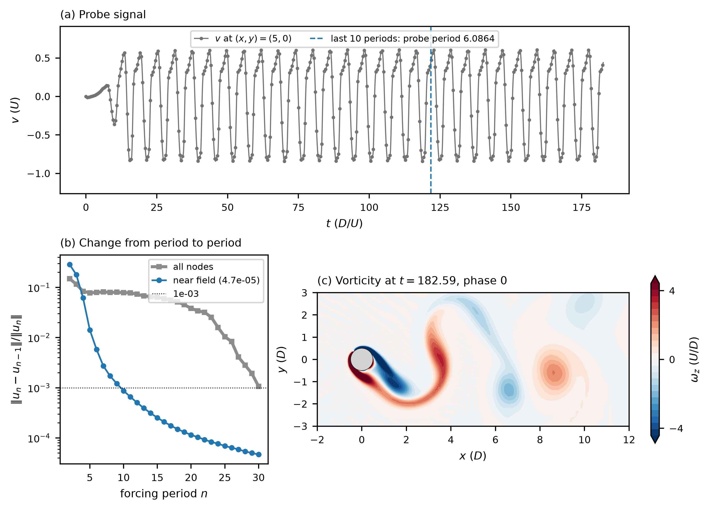

# moving_cylinder_re100 / 010_dns_forced — cylinder in forced transverse oscillation, DNS from rest

## What this case shows

The cylinder of diameter D moves across the stream with the displacement `A sin(2 pi f t)`, A = 1.08 D
(`userParam05`) and f = 0.1643 U/D (`userParam06`), at Re = 100. The mesh moves with it (`motion = user`): the mesh
velocity is the cylinder velocity `A 2 pi f cos(2 pi f t)` times a blending function that is 1 on the cylinder and 0 on
the outer boundaries (a Laplace solve in `my_base_meshv`, stiffer near the cylinder so that the deformation lies in the far
field). After some periods the wake locks to the forcing: the flow repeats with the period of the forcing, 1 / f = 6.0864 D/U,
and the fields at the same phase of the forcing stop changing. That periodic flow is the base flow of the Newton stage
`210_baseflow_newton` (mode 2.2) and of the Floquet stage `311_stability_direct_floquet` (mode 3.11). This stage is the start
of that chain: a DNS from rest, with one field per period, all at phase 0.

The forcing frequency lies 1.2 % below the Strouhal number of the static cylinder on this mesh (0.1663, from
`../000_dns/`).

## Settings that matter

- **No sponge, no filter.** The earlier `1cyl.usr` set a sponge in `nekStab_usrchk` (`xLspg = 10`, `xRspg = 20`,
  `spng_st = 1.7`) that forces the field toward its start value. With it the change from period to period stopped at
  2.6e-3 and the flow did not lock. The sponge lines are removed here, and the `.par` has `filtering = none`, as in the
  Newton and Floquet stages.
- **The time step divides the period.** `1cyl.usr` takes `dt` from the target CFL (0.35) and shortens it to
  `T / ceiling(T / dt)`: 3024 steps per period, `dt = 2.0127e-3`. The fields written at multiples of the period then fall on
  the same phase of the forcing.
- `fintim = 30 T` and `timeio = T`, set in `userchk`, replace `endTime` and `writeInterval` of the `.par`.

## Run

```bash
printf "1cyl\n%s/\n" "$(pwd)" > SESSION.NAME
mks 1cyl
sbatch --ntasks=8 run.local.slurm       # 17.5 min on 12 ranks (ifx, nexus-dev)
python plot.py
```

`plot.py` reads `1cyl.his` and the 30 fields `1cyl0.f000NN` and writes `lockin.dat` and `plot_lockin.png`. The fields are
not tracked; `210_baseflow_newton` copies the last one.

## Result

| quantity | value |
|---|---|
| forcing period 1 / f | 6.086427 |
| period of v at the probe (5, 0), last 10 periods | 6.086385 (6.9e-6 relative) |
| change from period 29 to 30, near field (-2 < x < 10, abs(y) < 4) | 4.7e-5 |
| the same over all nodes | 1.1e-3 |
| amplitude of v at the probe, last 5 periods | 0.7239 |

The near-field change is 2.9e-1 from period 1 to 2 and 1.4e-2 from period 4 to 5. After period 12 it falls by the factor 0.88
per period. The far wake that the start-up leaves behind travels out of the domain slowly: the change over all nodes is still
0.08 at period 10 and reaches 1e-3 at period 30. A seed for Newton needs the near field only; the Newton iteration removes the
rest.



`ref/reference.json` compares the probe period with the forcing period, the near-field change with 0, and the amplitude and
the number of fields with this run.

## Files

- `1cyl.par`, `1cyl.usr`, `SIZE`, `1cyl.re2`, `1cyl.ma2` — case; the mesh has 2128 elements at `lx1 = 6`
- `run.local.slurm` — run script, writes the probe list `1cyl.his`
- `plot.py` — measures the lock-in, writes `lockin.dat` and `plot_lockin.png`
- `ref/reference.json`, `ref/lockin.png` — regression values and figure
