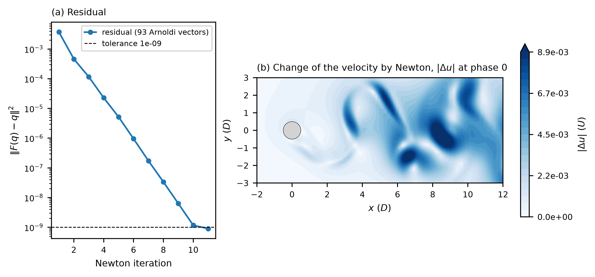

# moving_cylinder_re100 / 210_baseflow_newton — periodic orbit of the oscillating cylinder, Newton-GMRES

## What this stage does

The cylinder of `../010_dns_forced/` moves across the stream with the displacement `A sin(2 pi f t)`, A = 1.08 D and
f = 0.1643 U/D, at Re = 100. The wake locks to the forcing, so the flow is periodic with the period of the forcing,
T = 1 / f = 6.086427 D/U. This stage computes that periodic flow, the orbit, with Newton-GMRES (`userParam01 = 2.2`).

The period is not an unknown: the forcing sets it (`userParam01 = 2.1` is the natural orbit, where T is solved for, as in
`cylinder_re180/210_baseflow_newton`). Newton solves `F(q) - q = 0` for the field `q` at phase 0 of the forcing, where `F`
integrates the flow over one period on the moving mesh. Each Newton step solves its linear system with GMRES (`k_dim = 100`).
The matrix-vector product of GMRES integrates the perturbation equation, linearized about the orbit, over one period.
The linear tolerance is dynamic (`ifdyntol`): each linear solve stops at one fifth of the current residual, so a
correct Jacobian reduces the residual by a factor 0.2 per iteration or better.

The seed is the last field of the forced DNS (30 periods, phase 0). `run.local.slurm` copies `../010_dns_forced/1cyl0.f00030`
to `BF_seed_1cyl0.f00001`, and `startFrom = BF_seed_1cyl0.f00001 time=0` resets the time to the phase 0. The seed
is 2.6e-3 from the orbit in the near field (-2 < x < 10, abs(y) < 4) and 3.3e-3 over all nodes, relative to the l2 norm of
the velocity. The forced DNS of `010` changes by 4.7e-5 from period 29 to period 30 in the near field, and the change
falls by a factor 0.93 per period at the end.

## Moving mesh in the linearized solver

On a moving mesh Nek5000 solves the base flow in the arbitrary Lagrangian-Eulerian form and adds the term `B div(w u)`, with
the mesh velocity `w` of the user routine `my_meshv`. Its perturbation solver has no such term. Before the term was added to
nekStab (`ale_mesh_velocity_term` in `src/forcing.f90`), the linear system of Newton was not the Jacobian of the nonlinear
map. With the stage setup the squared residual then went 3.7e-3, 6.5e-4, 2.6e-4, 9.9e-5, 4.3e-5, 3.8e-5, 1.9e-5 in seven
iterations (factors 0.18 to 0.88), and the GMRES solves needed more and more vectors. With the term the residual falls by a
factor 0.12 to 0.25 per iteration. The reference below fails the first behaviour.

## Result

Eleven Newton iterations from the DNS seed (`residu_newton.dat` has the columns iteration, cumulative time steps, time steps
of the iteration, cumulative Arnoldi vectors, cumulative simulated time, linear tolerance, squared residual and Newton
tolerance):

| Newton iteration | cumulative Arnoldi vectors | squared residual `abs(F(q) - q)^2` | ratio |
|---|---|---|---|
| 1 | 0 | 3.718e-3 | |
| 2 | 2 | 4.604e-4 | 0.12 |
| 3 | 6 | 1.160e-4 | 0.25 |
| 4 | 11 | 2.284e-5 | 0.20 |
| 5 | 28 | 5.161e-6 | 0.23 |
| 6 | 49 | 9.529e-7 | 0.18 |
| 7 | 63 | 1.724e-7 | 0.18 |
| 8 | 70 | 3.363e-8 | 0.20 |
| 9 | 81 | 6.325e-9 | 0.19 |
| 10 | 91 | 1.173e-9 | 0.19 |
| 11 | 93 | 9.021e-10 | |

The run stops when the squared residual is below the Newton tolerance 1e-9. One period is 4133 time steps (`dt = 1.4726e-3`,
from the Courant number 0.35 of the seed), 471172 time steps in all. The run took 6687 s on 12 ranks (`ifx`, nexus-dev).

`BF_1cyl0.f00001` is the orbit at phase 0. Its time stamp is the period, 6.086427267194, which the Floquet stage reads as
the length of the map. The Floquet stage `../311_stability_direct_floquet/` takes this file and the same `SIZE`.



`plot.py` reads `residu_newton.dat`, the seed and the orbit, and writes `newton_change.dat` and `plot_newton.png`.
Panel (a) is the residual against the iteration with the tolerance as a dashed line. Panel (b) is the modulus of the
velocity change from the seed to the orbit at phase 0, in the cylinder frame.

## What the reference checks

`ref/reference.json` has the first residual of the run (the seed), the last residual against the tolerance 1e-9, the number
of iterations, the time stamp of the orbit against the period of the forcing, the distance from the seed to the orbit, and
the l2 norm of the velocity components of the orbit. The seed is 5e-4 from the orbit in the norm of `vx`, so a run that
returns the seed fails the last check. A run whose Jacobian lacks the mesh-velocity term ends at a residual above 1e-5
and fails the second.

## Run

```bash
printf "1cyl\n%s/\n" "$(pwd)" > SESSION.NAME
mks 1cyl
sbatch --ntasks=12 run.local.slurm      # 1 h 51 min on 12 ranks of nexus-dev (ifx)
python3 plot.py
python3 ../../../scripts/check_against_ref.py .
```

`../010_dns_forced/1cyl0.f00030` must exist (the field files are not tracked). `SIZE` has `lx1 = 6` and `lpmin = 8`, so the
run needs at least 8 ranks, which is also what the run script asks for.

## Files

- `1cyl.par`, `1cyl.usr`, `SIZE`, `1cyl.re2`, `1cyl.ma2` — case; the `.usr` sets the mesh motion (`my_meshv`), the end time
  `T`, and the time step that divides the period
- `run.local.slurm` — run script, copies the seed and writes the probe list
- `plot.py` — residual history and field change; writes `newton_change.dat` and `plot_newton.png`
- `ref/reference.json`, `ref/newton.png` — regression values and figure
