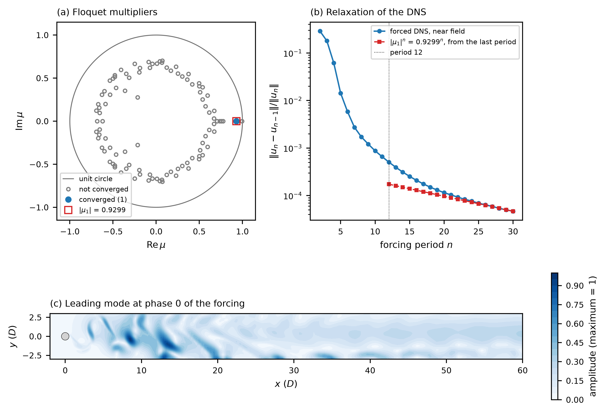

# moving_cylinder_re100 / 311_stability_direct_floquet — Floquet multipliers of the oscillating cylinder

## What this stage does

The cylinder of `../010_dns_forced/` moves across the stream with the displacement `A sin(2 pi f t)`, A = 1.08 D and
f = 0.1643 U/D, at Re = 100, and the wake locks to the forcing (`../210_baseflow_newton/` computes the orbit). This stage
asks whether the lock-in is stable: it integrates a perturbation of the orbit over one period of the forcing,
T = 1 / f = 6.086427 D/U, on the moving mesh, and finds the eigenvalues of that map with Krylov-Schur
(`userParam01 = 3.11`, `k_dim = 100`, one Arnoldi pass). These eigenvalues are the Floquet multipliers `mu`.
A perturbation of the orbit is multiplied by `mu` in one period, and its growth rate is `sigma = ln|mu| / T`.

The orbit is the file `BF_1cyl0.f00001` of stage 210, copied by `run.local.slurm`. The period is read from its time
stamp (6.086427267194). The stage uses the same `SIZE` (polynomial order 5, 2128 elements), no filter and no sponge as
the Newton stage, so the map is the derivative of the map that Newton found the fixed point of. On a moving mesh
this needs the mesh-velocity term of the perturbation equation (`ale_mesh_velocity_term` in `src/forcing.f90`;
DOC.md, section Moving Mesh).

## Result

One multiplier converges, and it is real and inside the unit circle:

| quantity | value |
|---|---|
| `mu_1` | 0.9298793 (residual 2e-10) |
| `sigma_1 = ln(mu_1) / T` | -0.011945 U/D |
| converged multipliers | 1 of 100 Ritz values |
| orbit closure `abs(U(T) - U(0)) / abs(U(0))` | 3.8e-7 |

The lock-in is stable. A real multiplier means that the perturbation decays without oscillating, by 7 % per period.
Its eigenvector lies in the wake: 33 % of its energy is within -2 D < x < 10 D, 41 % within 10 D < x < 30 D and 25 %
beyond x = 30 D, and the amplitude at |y| > 20 D (the lateral boundaries are periodic) is at most 5 % of the maximum.

The forced DNS of `../010_dns_forced/` relaxes onto the orbit with this multiplier. Its near-field change from period to
period falls by 0.9253 per period over the last five periods, 0.5 % below `|mu_1|` (panel (b)). The multiplier of the
solver without the mesh-velocity term does not match: its Floquet run has no converged value above modulus 0.72.

Check of the linearized map, made once with 30 Arnoldi vectors on the field of the forced DNS (period 30, not the
orbit): the linearized solver and finite differences of the nonlinear map (`iffindiff = .true.`, `ifstorebase = .false.`)
give 0.931905 and 0.931920 for the leading multiplier, and the eight leading multipliers agree to 4.4e-4. The solver
without the mesh-velocity term gives a pair of modulus 0.78 in place of 0.93.

The first Ritz value of the list is 0.996 or lower and is not converged (residual 5e-2). It changes from run to run:
0.9957 on 40 ranks, 0.9965 on 8 ranks, 0.937 in a second run on 40 ranks. It is part of the pseudospectrum of the map,
not an eigenvalue. `Spectre_Hd.dat` lists every Ritz value with a flag (column 4: 1 converged, 0 not); the files
`Spectre_Hd_conv.dat`, `Spectre_NSd_conv.dat` and `dRe1cyl0.f00001` hold the converged one only.

The run prints `nekStab: WARNING: no converged multiplier within 1e-3 of 1`. An autonomous orbit has the multiplier 1 of
its phase mode; an orbit locked to a forcing has none, so the message does not apply. The run took 33 min on 40 ranks
of Jean Zay (`ifort`) and 56 min on 12 ranks of nexus-dev (`ifx`); both give `mu_1 = 0.9298793`.



`plot.py` reads `Spectre_Hd.dat`, the leading mode and `../010_dns_forced/lockin_history.dat`, and writes `floquet.dat`
and `plot_floquet.png`. Panel (a) is the Ritz values in the complex plane with the unit circle. Panel (b) is the
near-field change of the DNS per forcing period against `|mu_1|^n` drawn through the last period. Panel (c) is the
amplitude of the leading mode at phase 0 of the forcing.

## What the reference checks

`ref/reference.json` has `mu_1` and `sigma_1` from the files of the converged values, the number of converged
multipliers, the relaxation factor of the DNS and the time stamp of the orbit file against the period of the forcing
(`plot.py` copies the time stamp of the orbit file, an input of the run, to the sixth column of `floquet.dat`).
A solver without the mesh-velocity term has a first converged multiplier of modulus 0.72 and fails the first two. An
export of the first values of the Ritz list (the behaviour before the fix of `outpost_ks`) puts 0.9957 in
`Spectre_Hd_conv.dat` and fails them too.

## Run

```bash
printf "1cyl\n%s/\n" "$(pwd)" > SESSION.NAME
mks 1cyl
sbatch --ntasks=12 run.local.slurm      # 56 min on 12 ranks of nexus-dev (ifx)
python3 plot.py
python3 ../../../scripts/check_against_ref.py .
```

`../210_baseflow_newton/BF_1cyl0.f00001` and `../010_dns_forced/lockin_history.dat` must exist (the field and data
files are not tracked). `SIZE` has `lpmin = 8`, so the run needs at least 8 ranks.

## Files

- `1cyl.par`, `1cyl.usr`, `SIZE`, `1cyl.re2`, `1cyl.ma2` — case; the `.usr` is the one of stage 210 with the Floquet
  branch (`userParam01 = 3.11`): `schur_tgt = 0`, `ifstorebase = .true.`
- `run.local.slurm` — run script, copies the orbit and writes the probe list
- `plot.py` — multipliers, DNS relaxation and leading mode; writes `floquet.dat` and `plot_floquet.png`
- `ref/reference.json`, `ref/floquet.png` — regression values and figure
