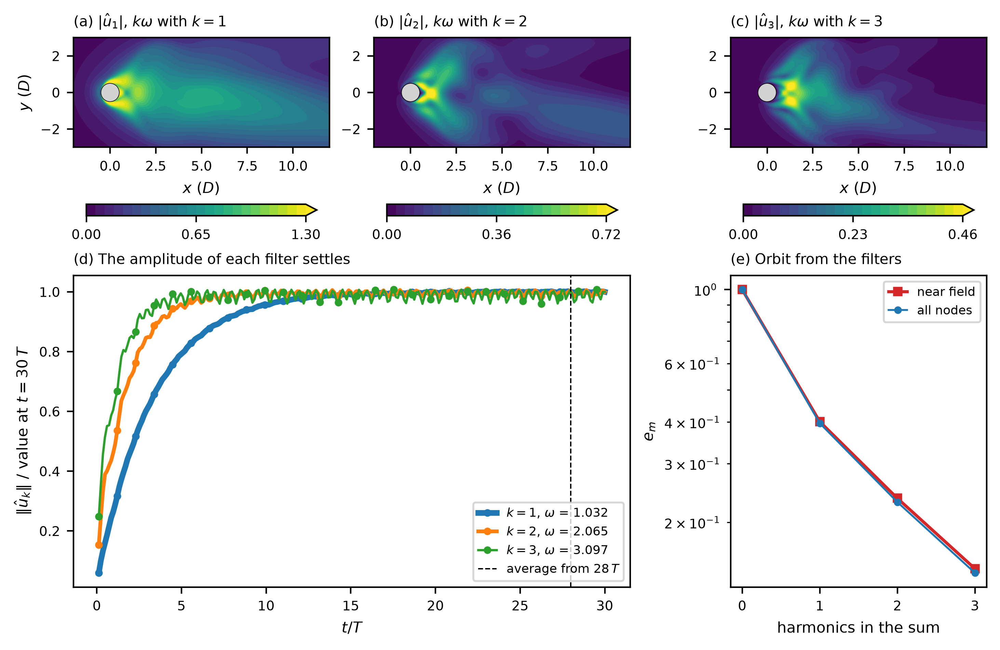

# moving_cylinder_re100 / 630_modal_dmt

DMT filter bank on the forced periodic orbit of the cylinder in transverse oscillation at Re = 100 (`userParam01 = 6.4`).
The DNS starts on the orbit of `../210_baseflow_newton`, runs 30 periods of the forcing with no force added, and four filters
watch the flow: at the frequency of the forcing, at its second and third harmonic, and at frequency 0 (the mean flow). Each
filter returns the spatial structure of the flow at one frequency as a complex field û(x), with u(x, t) ≈ Re[û(x) exp(iωt)].
The filter bank needs no stored snapshots: it runs in the time loop and writes the amplitudes at the end.

## Method

A filter of angular frequency ω and width β is a damped oscillator driven by the flow u at every point:

    p' = q,    q' = u − β q − ω² p,    b = β q

`b` is u filtered around ω, with gain 1 and phase 0 at ω and gain 0 at frequency 0. The complex amplitude is
û = (b − i b'/ω) exp(−iωt), with b' from the equations, so no data are differentiated. The filter is the one of mode 1.3
(Queguineur et al. 2019), used here to analyse the flow, not to force it. `DOC.md` ("Mode 6.4") has the derivation, the leakage
of a filter into the neighbouring frequencies and the files.

## Case

- 2D flow around a cylinder that moves across the stream with the displacement `A sin(2 π f t)`, A = 1.08 D and f = 0.1643 U/D
  (`userParam05`, `userParam06`), `viscosity = -100` (Re = 100), moving mesh (`motion = user`), 2128 elements, `lx1 = 6`,
  `lpmin = 8` (use 8 ranks or more). No sponge and no filter (`filtering = none`), as in stages 210 and 311.
- `startFrom = BF_1cyl0.f00001 time=0`: the orbit of stage 210 at phase 0 of the forcing, with the time set to 0. The run
  script copies it from `../210_baseflow_newton/`. Run that stage first.
- `endTime = 182.59`: 30 periods of the forcing, T = 1 / f = 6.086427. `1cyl.usr` replaces `endTime` by `30 / f`, takes the
  time step from the target CFL (0.35), 1.4729e-3, and shortens it to T divided by a whole number of steps, T / 4133 =
  1.4726e-3, fixed for the run (the DMT bank needs a constant step). The run takes 123991 steps; the last field is at
  t = 182.59429, one step after 30 T.
- Four filters, registered in `nekStab_usrchk` of `1cyl.usr` with ω₁ = 2π f = 1.0323:

  | filter k | frequency | width β |
  |---|---|---|
  | 1 | ω₁ | 0.1 ω₁ |
  | 2 | 2 ω₁ | 0.2 ω₁ |
  | 3 | 3 ω₁ | 0.3 ω₁ |
  | 4 | 0 (the mean flow) | 0.1 ω₁ |

  The slowest filter (k = 1 and k = 4, β = 0.103) settles to 1e-3 of its amplitude in 2 ln(1000)/β = 134 time units, 22
  periods. The amplitude is averaged over the last 2 periods, from t = 28 T (`avg_from`), which also removes the ripple from
  the leakage of the other harmonics.
- `hist_step = 500`: `dmt_bank.dat` has one row per 500 steps.

## Result (40 ranks of Jean Zay, `ifort`)

Wall time 643 s. The amplitude files are referenced to t = 0, which is phase 0 of the forcing, so at phase 0 the flow is

    u(x, phase 0) = mean + Σ_k Re û_k.

The orbit of stage 210 is the flow at phase 0, and the DNS started on it. `plot.py` rebuilds the orbit from the filters, one
harmonic at a time, and measures what is left, e_m = ‖u_orbit − mean − Σ_{k ≤ m} Re û_k‖ / ‖u_orbit − mean‖, in the norm of the
two velocity components over the near field −2 < x < 10, |y| < 4 (D):

| k | ω | ‖û_k‖ / ‖mean‖ | e_k (near field) | e_k (all nodes) |
|---|---|---|---|---|
| 0 | 0 | 1 | 1 | 1 |
| 1 | 1.0323 | 0.585 | 0.401 | 0.397 |
| 2 | 2.0646 | 0.220 | 0.236 | 0.230 |
| 3 | 3.0969 | 0.137 | 0.145 | 0.141 |

- Each harmonic lowers the remainder, by the factors 0.40, 0.59 and 0.61. The sum of the first three harmonics does not
  reach the orbit: 14.5 % of the norm of the fluctuation lies in the harmonics above the third.
- The filter amplitude has a known value on the cylinder wall. There the flow has the wall velocity, A 2π f cos(ωt) along y,
  so û_1 = (0, A ω₁) = (0, 1.1149), and the other amplitudes are 0. The filters return Re û_1,y = 1.1148 on the 96 wall nodes,
  and 6e-7, 2e-7 and 1e-6 for filters 2, 3 and 4 (`bank_wall.dat`).
- The imaginary part of û_1,y on the wall is −1.7e-3, a phase of −1.5e-3 rad, equal to ω₁ Δt for one time step. The wall
  velocity in the orbit file is A ω₁ cos(ω₁ Δt) = 1.1149122, not A ω₁ = 1.1149135: the discrete orbit follows the nominal
  forcing one step late. It is a property of the orbit, and it changes none of the numbers above in the third digit.
- The amplitude of the first filter is largest next to the cylinder: 1.42 at (x, y) = (0.16, −0.60), 0.12 D outside the wall.
  In the wake it is 0.57 or less beyond x = 10 (panel (a)). The second harmonic has its maximum, 0.86, on the axis at
  x = 1.09, and 0.21 or less beyond x = 10. The third has 0.52 at (1.31, 0.34), and 0.07 or less beyond x = 10 (panels (b)
  and (c)).

`ref/dmt_bank.png`: (a) to (c) the modulus of û_k for k = 1, 2, 3 (speed units of the free-stream speed U), (d) the norm of each
amplitude over its final value against t/T, with the start of the averaging window, (e) the remainder e_m against the number of
harmonics.



## Reference

`ref/reference.json` checks ten quantities of a fresh run: the remainder after one, two and three harmonics (2 %, 2 % and 3 %),
the norm of each amplitude over the norm of the mean flow (1 %, 1 % and 2 %), the amplitude on the cylinder wall (0.002 for
the first filter, 0.001 for the second and for the mean), and the time of the last field. A wrong frequency, filter width or
period moves these numbers. `python3 ../../../scripts/check_against_ref.py .` runs the check.

## Run

```bash
mks 1cyl
sbatch run.local.slurm        # 8 ranks or more; 643 s on 40 ranks of Jean Zay
uv run --with numpy --with matplotlib --with pymech python plot.py
python3 ../../../scripts/check_against_ref.py .
```

## Outputs

- `bRe1cyl0.f0000k`, `bIm1cyl0.f0000k`: Re û_k and Im û_k of filter k, averaged over the last 2 periods. The time stamp is the end
  of the run.
- `dmt_bank.dat`: time, ‖u‖, ‖u − Σ b_k‖ (what no filter holds), then ‖û_k‖ for k = 1 to 4.
- `1cyl0.f00001`: the last field of the DNS.
- `bank_check.dat`: m, e_m (near field), e_m (all nodes), ‖û_m‖/‖mean‖. `bank_wall.dat`: k, Re û_y and Im û_y on the wall.
  Both come from `plot.py`.
- `plot_dmt_bank.png`: copied to `ref/dmt_bank.png`.

## Literature

Queguineur et al. (2019), Phys. Fluids 31, 034101: the filter of Dynamic Mode Tracking.
