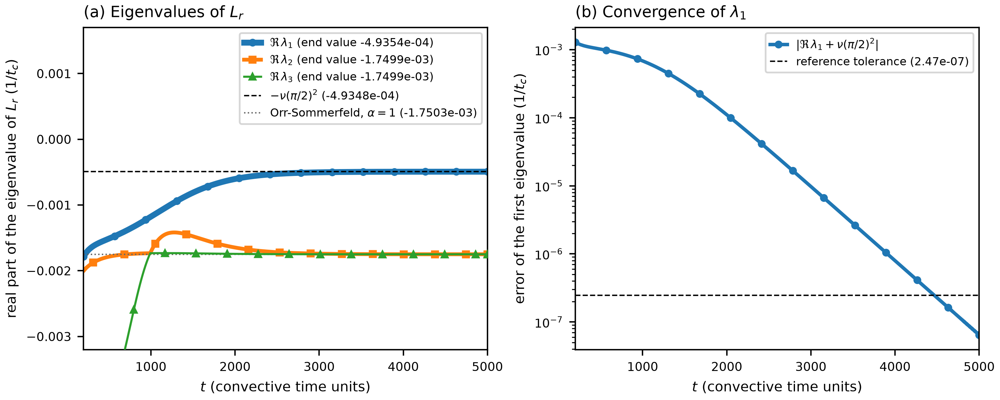
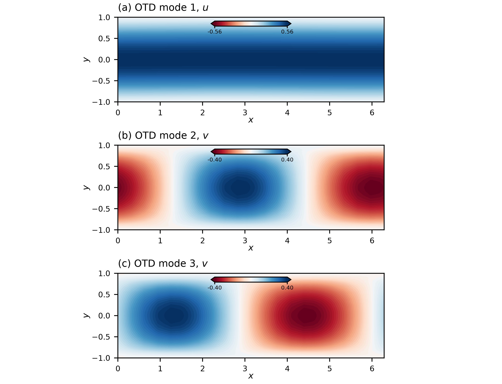

# poiseuille_re5k / 500_otd — OTD of plane Poiseuille flow at Re = 5000

## What this case shows

Three OTD modes (`lpert = 3`, `nekstab_mode = 'otd'` in the `.usr`, the same as `userParam01 = 5`) evolve with the linearized Navier-Stokes
equations about the frozen laminar profile U = 1 − y², from a white-noise start. The box is
periodic in x with length 2π and spans y = −1 to 1; Re = 1/ν = 5000 is based on the centre-line
velocity and the half-height. The mesh has 32 elements of order 7 (`lx1 = 8`), and the time
step follows a CFL number of 0.5 (about 0.05).

The linearized operator of this flow is known, so the stage checks the OTD machinery against
exact eigenvalues:

| mode | what the OTD basis converges to | exact value |
|---|---|---|
| 1 | x-independent, u = cos(πy/2), v = 0 | −ν (π/2)² = −4.934802e-4 |
| 2, 3 | the Tollmien-Schlichting wave of wavenumber α = 1 (real and imaginary part) | real part of the Orr-Sommerfeld eigenvalue −0.00175034 ± 0.26813148 i, i.e. −1.750340e-3 |

`orr_sommerfeld.py` computes the Orr-Sommerfeld eigenvalue by Chebyshev collocation. At the
critical point Re = 5772.22, α = 1.02056 it gives a growth rate of −3e-9, and at Re = 5000 it
gives the same eigenvalue to 1e-8 with 120 and with 200 points.

## Why the eigenvalues of the pair are real

The implementation removes the internal rotation of the basis in `otd_construct_linear_operator`:
it moves the lower triangle of the reduced operator `Lr` into a skew-symmetric term. The `Lr`
that is diagonalized is therefore upper triangular, its eigenvalues are its diagonal entries (the
Rayleigh quotients of the basis vectors), and `otd_eigenvalues.dat` holds real numbers. The
basis fields of modes 2 and 3 travel with the wave. They are the real and the imaginary part of
the wave, so the two entries are two real numbers whose sum is twice the real part σ of the
pair (the trace of `Lr` does not depend on the basis). The frequency of the wave is not in
`otd_eigenvalues.dat`.

## Settings

`SIZE` has `lpert = 3`. `poiseuille_OTD.usr` sets `otd_convTol = 0`, which turns the early stop
off. The stop compares the running average of the exponents between two print steps, and that
changes little long before the basis has converged (the explanation is in
`../../cylinder_re100/500_otd/README.md`). An earlier run of this stage with two modes and the
default stopped at t = 1640, where Re λ1 was −7.4e-4 against −4.9e-4 at the end.

`endTime = 5000`. The first eigenvalue approaches its exact value as exp(−2 gap t), with the
gap 1.26e-3 between mode 1 and the pair: the error falls by a factor 12 per 1000 time units.

## Result (Jean Zay, 4 ranks, `ifort`, 654 s)

| t | Re λ1 | Re λ1 + ν (π/2)² | Re λ2 | Re λ3 | running exponent of mode 1 |
|---|---|---|---|---|---|
| 500 | -1.5125e-03 | -1.02e-03 | -1.7874e-03 | -3.9717e-03 | -5.4084e-03 |
| 1000 | -1.1778e-03 | -6.84e-04 | -1.7118e-03 | -1.7338e-03 | -3.3825e-03 |
| 2000 | -6.0437e-04 | -1.11e-04 | -1.6473e-03 | -1.7438e-03 | -2.1115e-03 |
| 3000 | -5.0325e-04 | -9.77e-06 | -1.7409e-03 | -1.7493e-03 | -1.5862e-03 |
| 4000 | -4.9428e-04 | -7.96e-07 | -1.7492e-03 | -1.7498e-03 | -1.3139e-03 |
| 5000 | -4.9354e-04 | -6.45e-08 | -1.7499e-03 | -1.7499e-03 | -1.1499e-03 |

At t = 5000 the first eigenvalue is within 1.3e-4 (relative) of −ν (π/2)², and both entries of
the pair are 2.7e-4 from the Orr-Sommerfeld real part. A run to t = 10000 (Jean Zay, 4 ranks,
21 min) brings the first eigenvalue to within 2e-10 of the exact value from t = 7219. From
t = 5000 to 10000 the entries of the pair, and their mean, stay within 2.8e-4 of the
Orr-Sommerfeld value. The offset of 2.7e-4 does not change in that interval; it was not traced to
the mesh by a run at another resolution.





The running exponents of `otd_ftle.dat` average from t = 0 and still carry the start: they are
−5.4e-3 at t = 500 and −1.1e-3 at t = 5000 for mode 1. Read `otd_eigenvalues.dat` for this
stage. An earlier reference compared the running exponents at t = 500 with −1.511e-3 and −1.772e-3.
It did not reproduce: Jean Zay gives −5.41e-3 and −5.48e-3 there.

## Reference

`ref/reference.json` compares the last row of `otd_eigenvalues.dat` with the exact value −ν (π/2)²
and with the Orr-Sommerfeld real part (for each of the two entries of the pair), at a relative
tolerance of 5e-4 for all three. The values are not read back from an OTD run. The tolerance
fails the pair of an earlier version of the reduced operator (−1.7514e-3 and −1.7527e-3 at
t = 5000, 6.1e-4 and 1.4e-3 from the Orr-Sommerfeld value). In the run to t = 10000 the pair is
inside the tolerance from t = 4174 on and the first eigenvalue from t = 4466 on, so the end
time of 5000 leaves a margin of 530 time units for the first eigenvalue.
`python3 plot.py` writes `plot_otd_eigenvalues.png` (eigenvalues against time and the error of
the first eigenvalue) and `plot_otd_modes.png` (the three basis fields at the last output).

## Run

```bash
mks poiseuille_OTD
sbatch run.local.slurm      # 4 ranks
python3 plot.py
python3 ../../../scripts/check_against_ref.py .
```
