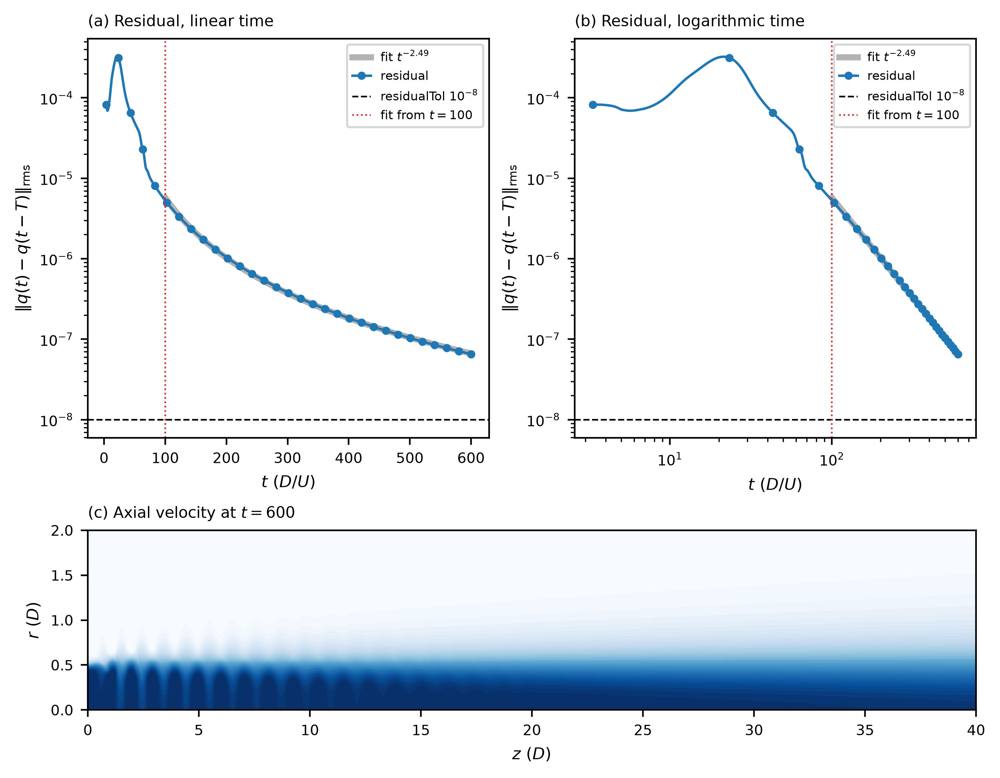

# Harmonically forced jet — time-delayed feedback, Re = 2000

## What this stage does
Time-delayed feedback (TDF, `userParam01 = 1.4`) holds the flow on its unstable periodic orbit. The solver
adds the force `g (q(t) - q(t - T))` to the momentum equation, with q the velocity field and T the period of the
forcing, T = 1 / `userParam05` = 1.66667. The gain `g = -0.04432 * 2 pi / T` is fixed in the code and negative, so the
force opposes the distance from the orbit. When the flow is on the orbit, the difference is zero and the force
vanishes, so the orbit of the Navier-Stokes equations is a state without force.

The residual is the root mean square over the domain of `q(t) - q(t - T)` (`residu.dat`, column 2; column 1 is
the time, column 3 the change of the residual per step). The run ends at `endTime = 600`. When the residual falls
below `residualTol = 1e-8`, the solver writes the converged field `BF_tpjet0.f00001`. The time step follows
`targetCFL = 0.5` and is adjusted so that a period holds a whole number of steps: the delay is then the period to
machine accuracy, which the method needs.

## Initial condition
`startFrom = BF_Re1900_tpjet0.f00001` is the orbit of the jet at Re = 1900 (AMR_Krylov paper, polynomial order 5,
the order of this run). The run is at Re = 2000, so the field is close to the orbit but not on it.

## Run
```bash
mks tpjet
sbatch run.local.slurm     # 16 ranks
```
The solver writes a snapshot every 100 time units (`tpjet0.f0000N`) and `residu.dat`.

## Result
The run takes 4880 s on 16 ranks of Jean Zay (`ifort`). The residual is 8.2e-5 at t = 3.3, the first period, rises to
its largest value, 3.2e-4, at t = 21.5, and then falls as a power law of the time:

| t | residual |
|---|---|
| 100 | 5.3e-6 |
| 300 | 3.8e-7 |
| 600 | 6.5e-8 |

A fit over t >= 100 gives residual = c t^-2.49 (`plot.py` writes it to `tdf_decay.dat`). The residual stays above
`residualTol = 1e-8` for the 600 time units, so the run writes no `BF_tpjet0.f00001`. The field at t = 600 (`tpjet0.f00006`) is
at the same phase of the forcing as the Newton orbit of `../210_baseflow_newton` (600 is 360 periods). Their difference is
1.9e-3 of the norm of the orbit (velocity, one measurement from the stored results); the seed, the orbit at Re = 1900, is at
1.05e-2. TDF has come closer to the orbit than the seed, and the Newton stage gives the orbit to a squared residual of 1e-8.



`ref/residual.png`: (a) and (b) the residual against the time on a linear and on a logarithmic axis, with the power-law fit
over t >= 100; (c) the axial velocity of the last snapshot.

## Reference
`ref/reference.json` checks seven quantities of `tdf_decay.dat` and the last snapshot: the exponent of the fit (within
0.05), the residual at t = 100, 300 and 600 and its largest value (10 %), the time of that value (1.0) and the time stamp of
the last snapshot. They are regression values of this repository, from the run named under `produced`.
`python3 ../../../scripts/check_against_ref.py .` runs the check after `python3 plot.py`.
