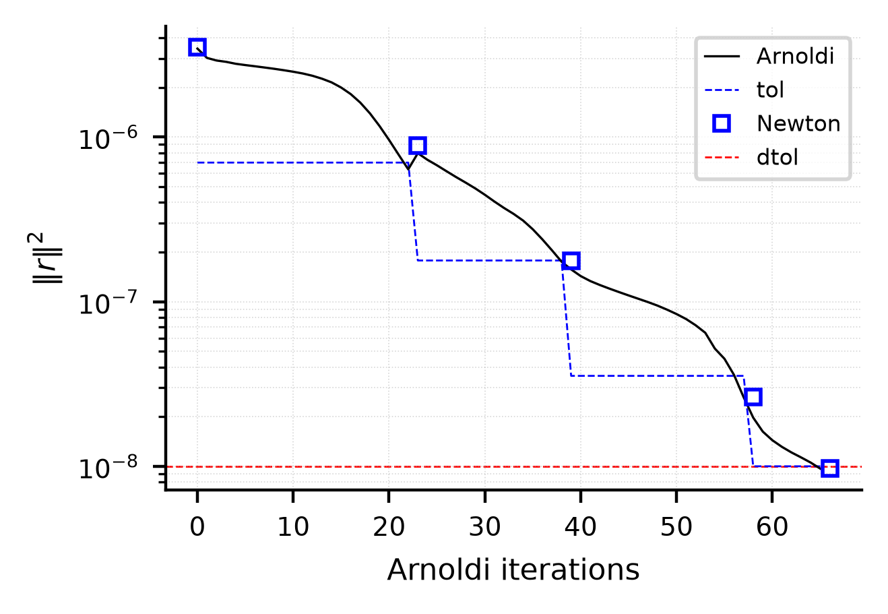

# Harmonically forced jet — forced periodic orbit (Newton-GMRES), Re = 2000

## What this stage does
Newton-GMRES (`userParam01 = 2.2`) finds the periodic orbit of the forced jet at Re = 2000: the field q(0) for
which the flow after one forcing period, F(q), returns to q. The period is T = 1 / St = 1.66667 (St = 0.6, `endTime`).
Each Newton step solves the linear system with GMRES (`userParam07 = 128` Arnoldi vectors) on the linearized
Navier-Stokes equations along the orbit. Each linear solve stops at one fifth of the residual at the start of its
iteration (`ifdyntol` in `tpjet.usr`). The residual is the squared norm of F(q) - q (`residu_newton.dat`,
column 7) and the tolerance is 1e-8. The unstable multiplier of the orbit is not a problem for Newton's method.

## Initial condition
`startFrom = BF_Re1900_tpjet0.f00001` is the orbit of the jet at Re = 1900 (AMR_Krylov paper, polynomial order 5,
the order of this run). The Reynolds number of the run is 2000, so the first residual is not zero. The stage does
not ship the orbit that Newton writes (`BF_tpjet0.f00001`): a shipped orbit would let a run stop after one
iteration. The stages `../311_stability_direct_floquet` and `../321_stability_adjoint_floquet` ship their own copy.

## Run
```bash
mks tpjet
sbatch run.local.slurm     # 16 ranks
```

## Result
Five Newton iterates, the seed and four updates, bring the squared residual below 1e-8. The run takes 2663 s on 16 ranks of Jean Zay (`ifort`),
22504 time steps (75 periods) in 66 Arnoldi vectors:

| Newton iterate | squared residual | Arnoldi vectors to reach it |
|---|---|---|
| 1 | 3.5e-6 | 0 |
| 2 | 8.9e-7 | 23 |
| 3 | 1.8e-7 | 16 |
| 4 | 2.6e-8 | 19 |
| 5 | 9.7e-9 | 8 |

The orbit has the axial velocity between -0.129 and 1.166, the radial velocity between -0.254 and 0.332 and the pressure
between -0.200 and 0.106. It lies at 1.05e-2 of the Re = 1900 seed in the relative norm of the velocity.



`ref/ic.png` is the seed, `ref/residual.png` the squared residual against the Arnoldi vectors (the squares are the Newton
iterates, the blue line is the tolerance of each GMRES solve), and `ref/bf.png` the axial velocity of the orbit.

## Reference
`ref/reference.json` checks the first and the last squared residual, the number of Newton iterates (within 1), the time
stamp of the orbit (the period) and the extreme values of the three fields of the orbit (1 % and 2 %). They are regression
values of this repository, from the run named under `produced`. `python3 ../../../scripts/check_against_ref.py .` runs the
check after `python3 plot.py`.
